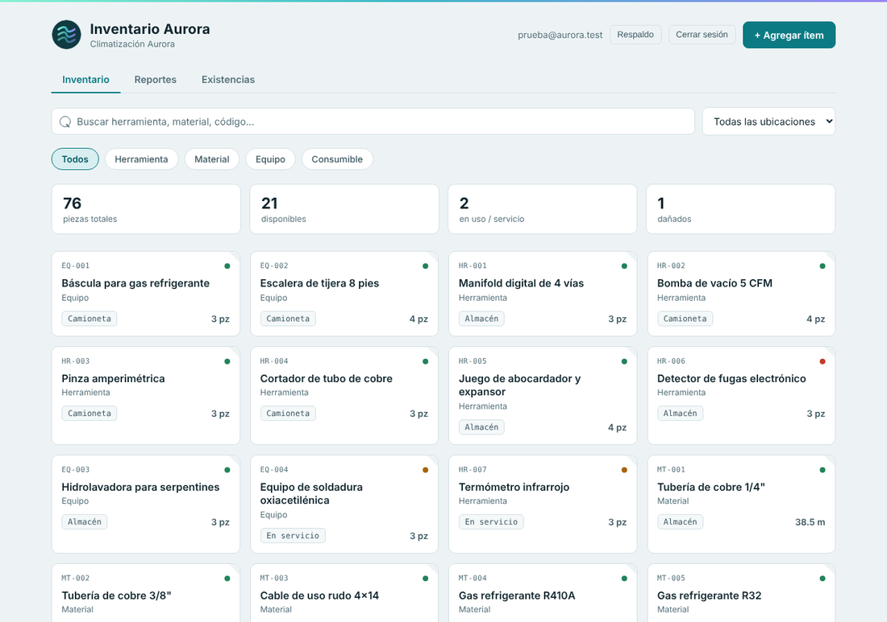
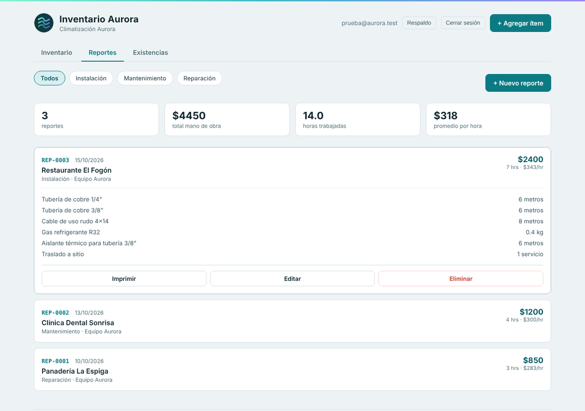
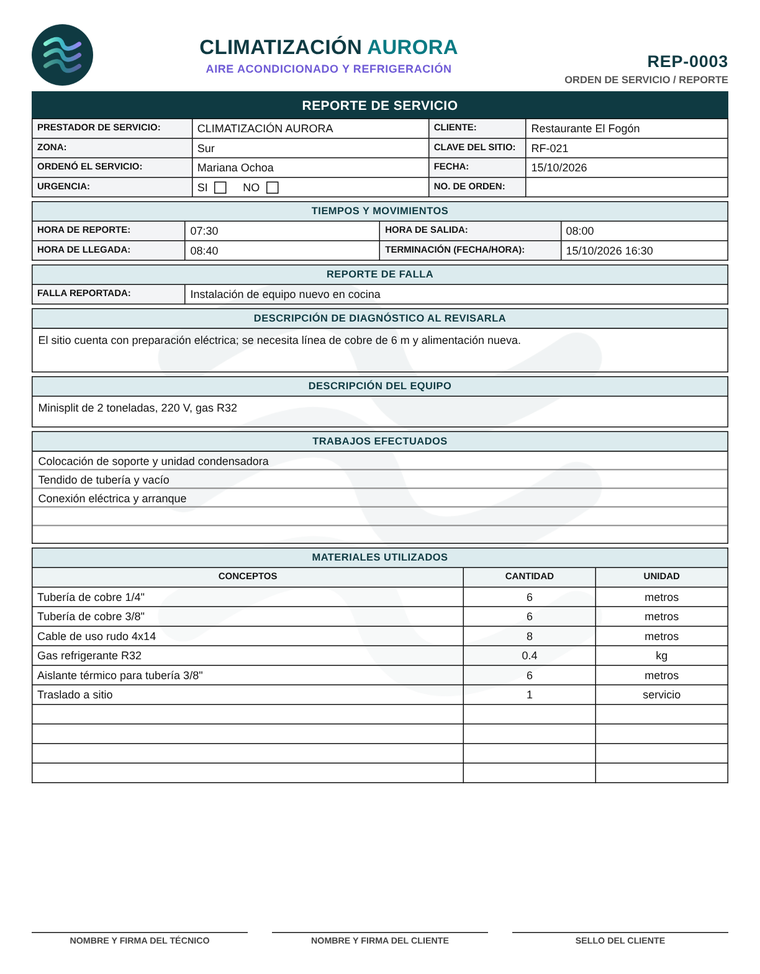
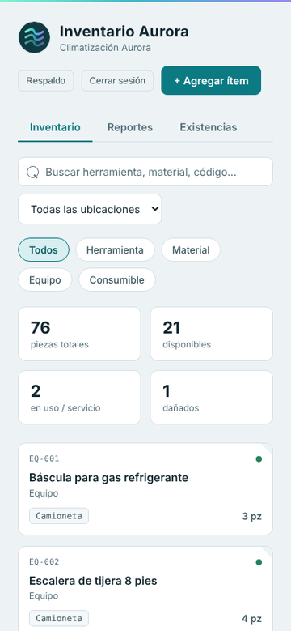

# Inventario Aurora

Aplicación web para llevar el inventario de una empresa de servicios técnicos y sacar sus reportes de servicio listos para imprimir. Funciona en el celular y en la computadora, y se puede instalar como app.

Climatización Aurora es una empresa inventada; todos los datos que salen en la demo son de ejemplo.

**Demo:** https://kyonoxc.github.io/inventario-aurora/

> **Cuenta de prueba**
> Correo: `AQUÍ_EL_CORREO_DE_LA_DEMO`
> Contraseña: `AQUÍ_LA_CONTRASEÑA_DE_LA_DEMO`

## Qué hace

- **Inventario** de herramientas, materiales, equipo y consumibles, con ubicación (almacén, camioneta, en servicio) y estado (disponible, en uso, dañado).
- **Piezas, metros o kilogramos.** El cable se descuenta en metros y el gas o la soldadura en kilos, con decimales exactos: 0.3 kg menos 0.1 kg menos 0.2 kg da 0, no 0.0000001.
- **Uso y compras** con historial por ítem: quién movió qué y cuándo.
- **Existencias:** lista de lo que está agotado o por agotarse, para saber qué comprar.
- **Reportes de servicio** con folio, mano de obra, materiales y servicios. Al guardar un reporte se descuenta el material del inventario. Si el reporte se edita o se borra, el inventario se ajusta solo.
- **Formato impreso** del reporte en una sola hoja carta, con vista previa.
- **Respaldo en Excel** con un botón.
- Acceso solo con correo y contraseña.

## El reporte impreso

El reporte siempre cabe en una hoja carta. La página mide el contenido en el mismo dispositivo y, si hay muchos materiales o textos largos, reduce el tamaño lo justo para que las firmas y el sello no se pasen a otra hoja.

## Cómo está hecho

- HTML, CSS y JavaScript en un solo archivo (`index.html`), sin frameworks y sin paso de compilación.
- [Supabase](https://supabase.com) para la base de datos (Postgres) y el login. Las reglas de seguridad (RLS) dejan ver y modificar datos solo a quien inició sesión.
- Publicado con GitHub Pages.
- PWA: `manifest.json` y un service worker que pide la página a la red primero, así las actualizaciones llegan solas, y abre la última copia si no hay señal.
- Las cantidades se guardan como `numeric(12,3)` y se redondean a tres decimales en el código para evitar errores de punto flotante.

## Correrlo con tu propia base de datos

1. Crea un proyecto en Supabase.
2. En **SQL Editor**, pega `sql/01_crear_base_de_datos.sql` y dale Run. Si quieres datos de ejemplo, corre después `sql/02_datos_de_ejemplo.sql`.
3. En **Authentication → Users**, agrega un usuario (marca *Auto Confirm User*).
4. En **Settings → API**, copia el *Project URL* y la llave *publishable*, y pégalos al principio del script en `index.html` (`SUPABASE_URL` y `SUPABASE_ANON_KEY`).
5. Sube los archivos a un repositorio y activa GitHub Pages (**Settings → Pages**, rama `main`, carpeta raíz).

La llave que aparece en el código es la *publishable* de Supabase, que es pública por diseño. Lo que protege los datos es el login y las reglas de la base. Conviene apagar el registro abierto (**Authentication**, opción para permitir que se registren usuarios nuevos) para que solo entren las cuentas que tú crees.

`02_datos_de_ejemplo.sql` borra todo lo que haya en ítems, historial y reportes antes de cargar los datos de ejemplo. Sirve también para dejar la demo como nueva.
